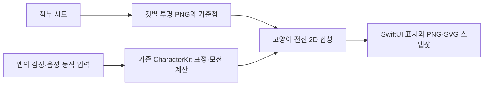

# CharacterKit 검은 고양이 전신 2D 애니메이션 조사와 개선 계획

조사 기준일 2026-11-22 (한국 시간) · 얼굴·실루엣 기준 및 원본 기반 구현 2026-11-23 · 조사 기준 CharacterKit `2.0.1` / `e9eed591`, CharacterStudio `55b423d3`

## 구현한 두 타입

- **펠트.** 첨부 시트의 검은 펠트 질감, 둥근 머리·짧은 다리, 크림색 눈을 기준으로 실제 포즈를 등록한다. 외곽선은 원화의 실루엣을 따라 보정한다. 얼굴은 기존 눈·입 위치에 따로 그려야 표정과 말하기가 가능하다. [원화와 자산 준비](../Artwork/FullBodyCat/README.md)
- **크레파스.** 조금 비뚤어진 귀와 서로 다른 크기의 눈, 단순한 면 안쪽의 짧은 색칠 자국으로 손그림 느낌을 낸다. 색칠 자국은 각 파츠 안으로 잘라 관절과 함께 움직인다. 겹치는 외곽선을 아래에 그려 관절 안쪽에 선이 두 겹으로 나타나지 않게 한다. [크레파스 도형과 포즈](../Sources/ReactiveCharacterKit/Scene/Anatomy/CrayonCat/CharacterCrayonCatGeometry.swift) · [색칠 자국](../Sources/ReactiveCharacterKit/Scene/Anatomy/CrayonCat/CharacterCrayonCatMarks.swift)

두 타입 모두 기본 자세 10개, 기존 감정 12개, 기존 표정·말하기 입력과 새 몸동작을 공유한다. 인사는 앞발을 들어 흔들고, 걷기는 네 발을 차례로 드는 제자리 동작이다. 펠트는 왼쪽과 오른쪽 정지 원화를 각각 몸통과 다리 네 장으로 분리한다. 정지와 보행은 방향별 얼굴 좌표와 털 원화를 공유한다. 얼굴과 몸은 같은 장면에서 실시간으로 합성되며 PNG와 SVG는 한 시점을 내보낸다. [몸동작 샘플러](../Sources/ReactiveCharacterKit/Presentation/CharacterFullBodyCatMotion.swift)

펠트의 검고 밝은 테두리는 원본 마스크 경계의 색 변화, 분리 파츠가 겹칠 때 알파가 겹친 부분, 움직이는 연결부의 배경 비침에서 발생했다. 바깥쪽의 얇은 영역에서만 주변 털 색을 사용하고 겹치는 알파를 한 외곽선의 범위로 조정했다. 꼬리·앞발·다리는 몸에 가려지는 부분까지 원본 털로 닫아 합성 화면에서 하나의 인형처럼 보이게 했다. 흰색·검은색·색 배경에서 네이티브 프레임을 같은 위치와 배율로 비교한다. [자산 준비와 검수](../Artwork/FullBodyCat/README.md)

펠트 자세 10개를 원본 시트의 각 자세에서 고해상도로 재제작했다. 몸·꼬리·앞발과 좌우 보행 파츠를 포함한 22개 레이어를 모두 1,024×1,024 PNG로 패키징한다. 눈·코·입은 기존 256단위 좌표의 얼굴 기준점 위에 그린다. 뒷모습은 원본처럼 얼굴 파츠를 표시하지 않는다. [고해상도 원화·프롬프트](../Artwork/FullBodyCat/HIGH_RESOLUTION.md)

## 펠트 고해상도 검수

- **자세 10개.** 같은 배율과 바닥선에서 네이티브 렌더를 비교했다. 새 자세 일곱 개의 등록 실루엣은 이전 원화 마스크와 약 89–95% 겹친다. 앱 번들에 포함된 22개 파일의 이름·해상도·SHA-256은 SDK 자산과 일치했다.
- **제자리 걷기.** 좌우를 각각 92pt와 280pt에서 2배율로 렌더해 612프레임을 검사했다. 팔다리와 꼬리가 떨어지거나 화면에 잘린 프레임은 없었다. 280pt 표본의 접지 오차는 정지 자세 기준 1pt 이내였다. 옆모습에서 말할 때는 입 모양이 바뀌고 실루엣 알파는 유지됐다.
- **macOS Character Studio.** 새 로컬 빌드에서 좌우 보기와 제자리 걷기, 식빵·배 보이기·뒷모습·털 세우기 전환을 실행했다. 한국어 음성 재생 중 옆모습과 앞발 인사를 확인했다. 놀람 감정을 지정해 재생했고, 뒷모습으로 전환한 뒤에도 음성이 이어졌다.

## 펠트 2D 애니메이션

SwiftUI가 시간에 맞춰 다시 그릴 때 CharacterKit이 같은 1,024×1,024 원화와 관절 좌표를 합성한다. 꼬리와 다리는 각 관절을 중심으로 움직이고, 눈·입·감정은 기존 얼굴 상태에서 따로 계산한다. 방향이나 실루엣이 크게 달라지는 순간에는 등록된 자세 원화로 전환한다. [SwiftUI TimelineView](https://developer.apple.com/documentation/swiftui/timelineview) · [Godot 2D 파츠와 회전축](https://docs.godotengine.org/en/stable/tutorials/animation/cutout_animation.html) · [SpriteKit 자세 프레임 교체](https://developer.apple.com/documentation/spritekit/animating-a-sprite-by-changing-its-texture)

- **제자리 점프.** 발을 디딘 상태에서 몸을 낮추고, 공중에서는 곡선을 따라 떠오른다. 좌우 옆모습은 각각의 보행 원화에서 앞발과 뒷발을 접어 올린다. 착지하면 몸이 다시 눌렸다 제 비율로 돌아온다. 모션 감소 모드에서는 대표 자세를 잠시 표시한다.
- **기지개.** 앞발을 내미는 자세 원화를 바탕으로 몸이 낮아지고 앞으로 늘어나는 시간을 두었다. 얼굴은 몸과 같은 좌표를 따라가면서 말하기와 표정을 합성한다.
- **Studio 재생.** 펠트 고양이를 선택하고 **펠트 애니메이션**을 누르면 약 14초 동안 숨 쉬기, 점프, 좌우 제자리 걷기, 인사, 기지개, 배 보이기를 재생한다. 재생이 끝나거나 중지하면 사용자가 선택한 자세로 돌아간다. 개별 점프는 **자세와 동작 → 제자리 점프**에서 실행한다. 실제 macOS 앱에서 연속 재생과 자세 복귀를 확인했고, 연속 재생 중 한국어 대사와 감사 표정도 확인했다.
- **영상 검수.** 같은 CharacterKit 렌더러에서 1280×720, 30fps, 15.8초 무음 MP4를 만들었다. 영상용 좌우 걷기에는 무대 안 가로 이동을 더했다. 474프레임을 디코딩해 외곽 잘림을 검사했다. 점프 자동 검증은 기본 서기와 양 옆모습에서 준비·공중·착지·복귀의 알파 실루엣과 발 높이를 확인한다.

### 서기에서 몸동작으로 전환

CharacterKit은 기존 펠트 PNG 22장과 동작 좌표를 번들에 넣는다. 렌더러는 좌표에서 외곽선과 질감의 원본 위치를 읽어 중간 모습을 화면에 그릴 때 생성한다. 정지 자세 10개는 서기를 경유하는 경로로 연결한다. 배 보이기의 머리와 발, 몸을 돌 때의 꼬리는 각 파츠의 움직임에 맞춰 원화의 펠트 질감을 읽는다. [전환 재생](../Sources/ReactiveCharacterKit/Presentation/CharacterFullBodyCatMotion.swift) · [렌더러](../Sources/ReactiveCharacterKit/Rendering/Apple/CharacterFeltCatRigRenderer.swift)

| 경로 | 중간 동작 | 진입 / 복귀 |
| --- | --- | --- |
| 좌우 제자리 걷기 | 디딘 발을 축으로 몸을 돌린다. 체중을 옮겨 발을 먼저 들어 올리고, 바닥에 닿기 직전에 내려오는 속도를 줄인다. 발 디딤은 반대쪽 몸 이동을 보정한다. | 0.48초 / 0.48초 |
| 기지개 | 가슴을 낮추고 앞발을 내민 뒤 몸을 길게 편다. | 0.45초 / 0.43초 |
| 배 보이기 | 몸을 낮추고 옆구리를 바닥에 댄 다음 발을 접고 고개와 꼬리를 눕힌다. | 0.56초 / 0.57초 |

중간 자세마다 눈과 입의 위치를 등록했다. 옆모습으로 돌 때 가려지는 눈과 입선이 좁아지고, 구를 때는 얼굴 파츠가 머리의 기울기를 따라간다. 표정과 말하기는 몸 위에 계속 합성한다. Studio 시연은 좌우 방향을 지정하되 시작 자세를 서기로 유지해 두 걷기 모두 중간 동작을 재생한다. [얼굴 좌표 생성](../Artwork/FullBodyCat/emit_transition_faces.py)

자동 검사는 앱의 원화 PNG 22개와 생성 프레임의 PNG·SVG 내보내기, 자세 전환의 바닥선과 실루엣, 발화 중 입 모양과 몸의 알파, 보행 시작과 복귀를 확인한다. [동작 좌표 제작과 재생성](../Artwork/FullBodyCat/Transitions/README.md)

### 자세 전환 품질과 털 세우기 방향

Adobe의 Puppet은 관절점, 국소 강성, 겹침 순서를 따로 제어한다. Godot의 2D 컷아웃은 회전축과 그리기 순서를 분리하고, Spine은 메시가 접힐 때 보이는 면의 순서를 제어한다. 이 구현은 같은 원칙으로 머리와 몸통, 지지하는 발과 움직이는 발을 나누고 관절이 교차하는 구간의 가림을 작성한다. 각 자세는 Apple이 스프라이트 교체에 권장하는 공통 크기와 기준점을 사용한다. [Adobe Puppet](https://helpx.adobe.com/after-effects/desktop/animate-in-after-effects/animate-with-puppet-tools/animating-puppet-tools.html) · [Godot 2D 컷아웃](https://docs.godotengine.org/en/stable/tutorials/animation/cutout_animation.html) · [Spine 메시 가중치](https://us.esotericsoftware.com/spine-weights) · [SpriteKit 프레임 등록](https://developer.apple.com/documentation/spritekit/animating-a-sprite-by-changing-its-texture)

앞발 인사에서는 한 발로 몸을 지탱하며 다른 발이 어깨에서 올라간다. 뒷발 서기에서는 두 앞발의 접히는 시간을 어긋나게 했다. 식빵 자세는 하체를 둥글게 접고 꼬리를 골반 뒤에서 앞으로 감는다. 회전은 머리와 어깨의 겹침과 꼬리가 가려지는 순서를 조정한다. 배 보이기는 등 윤곽을 둥글게 다듬고 구르는 중간 자세 간격을 고르게 맞춘다. [앞발과 꼬리 좌표 제작](../Artwork/FullBodyCat/prepare_plant_polish.py) · [몸통 회전 좌표 제작](../Artwork/FullBodyCat/prepare_turn_polish.py)

Studio 무대의 **털 세우는 방향**에서 왼쪽이나 오른쪽을 선택하면 **털 세우기**와 **깜짝 놀라기**에 적용된다. 오른쪽은 기존 오른쪽 회전 좌표를 공유하고 옆모습이 나온 뒤 등을 세운다. 오른쪽 끝 자세는 같은 원화에서 몸을 반전하고, 얼굴 기준점과 시선은 화면 방향에 맞춰 계산한다. [방향 입력](../Sources/ReactiveCharacterKit/Appearance/CharacterFullBodyCatAppearance.swift)

### 동그란 펠트를 공통 중간 자세로 쓰는 안

같은 털 텍스처와 바닥선을 사용해 오른쪽 회전과 배 보이기를 각각 원형으로 모으는 실험을 했다. 공통 윤곽은 파츠가 겹치는 순간을 줄이고, 장난감이 모습을 바꾸는 장면에는 읽기 쉬운 중간 자세가 된다. 몸의 방향이 바뀌는 회전에서는 몇 프레임 동안 귀와 목, 네 발이 사라져 회전에 필요한 정보가 줄었다. 배 보이기에서는 기존 얼굴 좌표가 원형 경계와 맞지 않아 표정을 유지하려면 얼굴 경로도 다시 등록해야 한다. 현재 시스템도 서기를 거쳐 경로를 재사용하므로 공통 자세를 원형으로 바꿔도 자세별 시작과 끝의 조정은 남는다.

공통 원형은 실험에 남겼다. 식빵 자세와 배 보이기는 몸을 둥글게 접고, 회전은 몸통이 잠시 좁아지며 꼬리와 먼 쪽 다리가 몸 뒤로 가려지도록 했다. 눌리고 펴지는 변형으로 재질을 전달하고, 관절과 겹침 순서로 동작의 방향을 유지한다. [Pixar in a Box의 재질과 변형](https://www.khanacademy.org/computing/pixar/animate/ball/v/animate-4) · [Adobe Puppet의 겹침 순서](https://helpx.adobe.com/after-effects/desktop/animate-in-after-effects/animate-with-puppet-tools/animating-puppet-tools.html)

자세를 연달아 바꾸거나 동작을 취소하면 화면에 보이던 중간 좌표에서 시작한다. 보행 중단 시 현재 발의 움직임을 120ms 동안 줄이고 자세 전환을 이어간다. 두 경로를 거치는 동작은 60Hz 재생에서 좌표 사이를 건너뛰지 않도록 구간별 최소 시간을 확보한다. 앞발을 든 채 오른쪽으로 놀랄 때는 약 1.45초를 써서 모의 재생의 네 샘플 위상에서 중간 자세 52개를 모두 표시했다. 호출자는 `actionDuration`에서 해당 자세의 재생 길이를 조회할 수 있다. [재생과 취소 처리](../Sources/ReactiveCharacterKit/Presentation/CharacterFullBodyCatMotion.swift)

두 타입의 감정 연기는 얼굴과 같은 시점에서 샘플링한다. 기쁠 때는 걷는 발을 더 높이 들고 앞발을 넓게 흔든다. 피곤할 때는 발을 낮게 들어 조심스럽게 내딛는다. 발을 디딘 동안의 좌표와 네 발의 순서는 그대로 유지한다. 감정 전환 중에는 발 들림과 꼬리 흔들림의 폭을 얼굴 상태와 함께 보간한다. 말하기는 같은 몸동작 위에서 입을 독립적으로 그린다. [감정 모션](../Sources/ReactiveCharacterKit/Presentation/CharacterEmotionMotion.swift)

### 크레파스의 자세 전환

크레파스는 둥근 면 위에 비뚤어진 귀, 간단한 선, 짧은 색칠 자국을 그린다. 자세가 바뀔 때 대응하는 머리와 몸통, 팔·다리의 윤곽과 색칠 영역을 함께 보간한다. 도중에 새 동작을 선택하면 현재 보이는 그림을 기준으로 이어간다. Studio에서 두 타입을 함께 선택하고 **동작 시연**을 누르면 같은 대사와 동작을 나란히 비교할 수 있다. [크레파스 도형 보간](../Sources/ReactiveCharacterKit/Scene/Anatomy/CrayonCat/CharacterCrayonCatMorph.swift)

### 용량과 렌더링 검증

원본 PNG 22장과 모션 좌표 707,899바이트가 앱에 들어간다. 자세 사이의 중간 PNG는 화면에서 생성한다. 앱을 열 때는 털 텍스처를 준비하고 실제 프레임은 요청할 때 그린다. 동일 프레임에 요청이 겹치면 완성된 이미지 한 장을 공유한다. [렌더러 캐시](../Sources/ReactiveCharacterKit/Rendering/Apple/CharacterFeltCatRigRenderer.swift)

접근성의 이미지 확인은 모션 좌표와 번들 리소스를 조회한다. macOS 릴리스 빌드에서 전환 프레임 98개의 첫 조회를 각 버전 3회 측정한 결과, 회차별 중앙값의 중앙값이 5.00ms에서 0.004ms로 줄었다. Canvas에서 생성한 98개 전환 프레임의 RGBA 해시는 일치했다. [이미지 조회](../Sources/ReactiveCharacterKit/ResourceIO/CharacterReferenceResource.swift)

펠트 보행 렌더러는 픽셀을 최종 버퍼에 그린 뒤 같은 버퍼를 CGImage에 전달한다. 프레임마다 약 4MiB의 복사가 한 번 줄었다. macOS 릴리스 빌드에서 좌우 각각 128프레임을 4회씩 측정한 결과, 회차별 프레임 생성 중앙값의 중앙값은 왼쪽 3.40→2.76ms, 오른쪽 3.29→2.77ms였다. 256개 프레임의 RGBA 해시는 일치했다. [보행 렌더러](../Sources/ReactiveCharacterKit/Rendering/Apple/CharacterFeltWalkRenderer.swift)

## 조사 결론과 인수 범위

**원본의 검은 질감을 살리면서 얼굴·몸통·행동·표정을 함께 움직이는 데 가장 적합한 방식은 ‘새로 그린 얼굴 파츠 + 불투명한 몸 원화 + 자세별 2D 프레임’을 CharacterKit에서 실시간 합성하는 것이다.** 시트에서 몸의 비율과 질감을 가져오고, 눈·눈꺼풀·입은 기존 고양이들과 같은 방식으로 독립 저작한다. 완성된 고양이는 내부 전체가 불투명하다. RGBA PNG의 투명도는 배경, 다리 사이의 실제 빈 공간, 외곽선의 얇은 안티앨리어싱에 사용한다.

첫 검증은 네 발로 선 한 포즈에서 얼굴과 몸을 함께 움직인다. 제품 인수 범위는 기존 감정 12개·액션 8개와 시선·깜빡임·말하기, 전신 대기·앞발 인사·식빵 자세를 포함한다. 공유용 투명 움직임은 APNG를 우선 비교한다. SVG는 선·도형이나 단일 장면 내보내기에 쓸 수 있고, GIF는 파일 호환이 필요한 경우에 쓴다.

이 그림의 입체감은 원래 JPG에 들어 있는 명암과 질감이다. 2D에서 쓸 수 있는 동작은 그림 조각의 이동·회전·크기 변화와 프레임 교체다. 꼬리 흔들기와 눈깜빡임은 소수의 조각으로 가능하고, 자연스러운 사족 보행과 몸을 뒤집는 전환은 시트에 없는 중간 그림이 필요하다. 외부 엔진, 새 리깅 도구, 영상 생성 서비스 없이 첫 버전을 만들 수 있다. [Godot 컷아웃 가이드](https://docs.godotengine.org/en/stable/tutorials/animation/cutout_animation.html) · [Apple 스프라이트 프레임 애니메이션](https://developer.apple.com/documentation/spritekit/animating-a-sprite-by-changing-its-texture)

| 원하는 동작 | 어느 정도 쉽게 가능한가 | 필요한 원화 |
| --- | --- | --- |
| 눈깜빡임·말하기·감정 12개 | 눈·눈꺼풀·입 파츠의 모양을 먼저 저작하고, 기존 pose 값으로 전환과 말하기를 연결한다. | 얼굴 요소를 지운 불투명 머리, 새로 그린 왼눈·오른눈·눈꺼풀·입, 위치가 고정된 코 |
| 서 있는 채 숨쉬기·끄덕임 | 쉽다. 발 쪽을 고정한 작은 몸 변형 및 기존 액션을 쓴다. | 전신 한 컷. 머리만 움직여야 자연스러우면 머리 레이어 추가 |
| 꼬리 흔들기 | 비교적 쉽다. 몸 뒤로 들어가는 꼬리 뿌리를 보정하고 각도를 작게 바꾼다. | 꼬리 1장과 몸통 뒤 겹침 여유. 경계가 드러나면 꼬리 프레임 2장 |
| 앞발 인사·식빵 자세 | 가능하다. 인사 자세에서 앞발만 움직이고, 식빵 자세는 별도 컷으로 전환한다. | 기존 인사·식빵 컷. 인사용 앞발 레이어 또는 같은 시점의 두 번째 앞발 컷 |
| 네 발 걷기·달리기·뒤집기 | 별도 제작이 필요하다. 우선순위가 생기면 동작 하나만 시험한다. | 같은 시점의 보행 키포즈나 발이 닿는 중간 프레임, 승인된 연속 원화 |

## 첨부 이미지에서 확인한 것

원본은 `845996900_17986676232109569_1470082081660408522_n.jpg` 한 장의 1672×941 RGB JPEG다. 시트의 다른 그림은 서로 다른 시점과 포즈를 보여주는 참고 컷이다. 레이어나 시간 순서가 없고, 앞발 뒤나 꼬리 뿌리처럼 가려진 픽셀은 보이는 그림에서 가져올 수 없다. 시트 오른쪽의 표정은 작은 차이가 있으므로 얼굴 전체를 바꾸면 표정보다 시점과 눈·코 위치 차이가 먼저 보일 수 있다.

| 시트 구역 | 실제 활용 |
| --- | --- |
| `TURNAROUND` 정면·좌·우·후면 | 정면은 큰 기본 컷 후보. 좌우·후면은 방향별 독립 이미지와 포즈 참조로 쓴다. |
| `EXPRESSIONS` 평온·기쁨·슬픔·놀람·결의 | 크림색 눈·코·입의 위치와 비율을 확인하는 참고 자료. 감정이 읽히는 눈·눈꺼풀·입 형태를 별도 저작한다. |
| `POSES` 네 발로 서기·식빵·앞발 인사 | 가장 직접적인 첫 캐릭터 후보. 서기·인사는 시점과 머리 크기를 비교해 선택한다. 식빵은 같은 바닥선에 얹는다. |
| `POSES` 뒷발 서기·털 세우기·배 보이기 | 이후 추가할 독립 포즈. 극적인 자세 변화에 필요한 중간 그림의 참조가 된다. |
| `BASE` 얼굴·전신 | 얼굴은 눈·코·입 색과 비율 기준. 전신은 다리를 뻗은 실루엣이라 달리거나 점프하는 포즈 참고에 적합하다. |
| `DAILY LIFE`·`PROPS` | 공·방석·상자는 배경 소품 후보. 상자 앞판처럼 고양이를 가리는 부분은 별도 레이어가 필요하다. |

### Mac 로컬 실측

macOS 27.0.1 arm64에서 ImageIO/Core Graphics로 원본을 메모리에서 잘랐다. 잘라낸 컷마다 Vision의 `VNGenerateForegroundInstanceMaskRequest`와 `VNDetectAnimalBodyPoseRequest`를 실행했다. 표의 좌표는 원본 좌상단 기준 `x, y, 너비, 높이`이며, 실루엣 크기는 Vision 마스크의 알파가 0.5 이상인 영역을 둘러싼 사각형이다. 관절은 신뢰도 0.5 이상만 셌다. [전경 마스크 API](https://developer.apple.com/documentation/vision/vngenerateforegroundinstancemaskrequest.md) · [Apple 동물 관절 인식](https://developer.apple.com/videos/play/wwdc2023/10045/)

| 컷 | 자르기 픽셀 좌표 | 전경 수 | 실효 실루엣 | 동물 관절 |
| --- | --- | ---: | ---: | ---: |
| TURNAROUND 정면 | `115, 39, 270, 231` | 1 | 217×209 | 0 |
| TURNAROUND 좌측면 | `435, 32, 360, 236` | 1 | 316×216 | 9, 그중 꼬리 1 |
| POSES 네 발로 서기 | `874, 242, 218, 162` | 1 | 172×147 | 0 |
| POSES 식빵 자세 | `1146, 263, 205, 142` | 1 | 166×107 | 0 |
| POSES 앞발 인사 | `880, 442, 201, 158` | 1 | 168×141 | 0 |
| BASE 얼굴 | `22, 678, 218, 203` | 1 | 194×180 | 0 |
| BASE 전신 | `239, 661, 285, 219` | 1 | 261×203 | 0 |
| 시트 전체 | `0, 0, 1672, 941` | 20 | 1603×856 | 미실행 |

- 각 컷을 먼저 자르면 고양이 한 개의 마스크를 얻었다. 검사한 일곱 컷 모두 알파 0.5 이상인 픽셀이 자르기 영역의 테두리에 닿지 않았다. 이는 크롭 여유가 있었다는 측정값이다. 털과 내부 구멍의 품질은 합성으로 따로 확인했다.
- 별도로 투명 합성해 확인했을 때, 정면 고양이의 화면 왼쪽 크림색 눈 일부가 투명해져 배경색이 비쳤다. 정면 크롭 `129, 37, 247, 226`에서 원본 `(190,129)`의 알파는 255였으나 자동 결과는 0이었다. 진단에서 이 자리에 원본 눈 픽셀을 복구했을 때 색 배경이 비치지 않았다. 제품용 머리는 이 자리를 털 바탕으로 채운 뒤 새 눈 파츠를 얹는다. 검은 배경에서는 옅은 외곽 테두리도 보였다. `POSES` 네 발로 서기는 색 배경의 100px 표본에서 두 눈이 유지됐다. 다리 사이의 실제 빈틈은 남긴다.
- Apple 관절 API는 고양이와 개의 귀·꼬리·다리를 포함해 최대 25개 지점을 검출한다. 이 그림에서는 정면·서기·인사에 결과가 없고, 좌측면도 충분하지 않았다. 이 캐릭터의 눈, 발, 꼬리 뿌리 좌표는 제작할 때 직접 찍는 편이 쉽다. [Apple 동물 관절 인식](https://developer.apple.com/videos/play/wwdc2023/10045/)
- 현재 원화는 작은 UI용으로 먼저 검증할 수 있다. 92pt를 2×로 표시하면 최대 184px, 3×면 276px이다. 280pt의 2×는 최대 560px이다. 실제 그림 크기는 뷰 여백과 fit 비율에 따라 달라진다. `POSES` 전신의 172px 안팎을 큰 화면에서 확대하면 눈·입·털 디테일의 손실이 예상된다. 큰 화면이 중요하면 같은 포즈의 고해상도 단독 컷을 먼저 확보한다.

실측에서 검증한 범위는 전경 검출과 일부 투명 합성이다. 서비스에 원본을 업로드하지 않았으며, CharacterKit에서 이 고양이를 재생하거나 기기별 품질과 성능을 측정하는 단계는 구현 후 검증 대상으로 남아 있다.

현재 CharacterKit `2.0.1`의 macOS 기준선은 전체 Xcode 도구 체인에서 `swift test`로 확인했다. XCTest 380개와 Swift Testing 47개가 통과했다. 이 결과는 기존 SDK의 회귀 기준선이다. iOS 빌드, 새 캐릭터의 재생과 Studio 통합은 구현 후 별도로 검증한다.

### qa-visual 재검사

검사 역할은 배경 위에 합성하는 캐릭터 일러스트다. 고정 입력은 ICC sRGB IEC61966-2.1의 1672×941 JPEG, SHA-256 `82c449c8cda29031f4cee1890d3a552026e024cf4d0990f59fe817466667ae51`이다. 원본을 눈으로 확인하고, 앞서 기록한 사각형 및 추가 컷을 같은 Vision 요청으로 검사했다. 자동 마스크를 흰색·검은색·분홍 배경에 올려 비교했다. 합성판의 포즈 간 배율은 동일하다. 동물 관절 인식 수치는 이전 표의 크롭에 해당한다.

자동 마스크의 알파를 0~255로 환산했다. 경계 상자는 알파 128 이상, 반투명은 1~254로 셌다. 아래의 양쪽 눈 크기 및 밝은 픽셀 수는 원본에서 분리한 눈 영역에 RGB 세 채널이 모두 170 이상인 픽셀을 기준으로 한다. 밝기 기준은 눈의 내부 보존을 비교하는 진단 방법이다. 눈 전체 면적, 털 보존율, 앱 외관의 점수로 해석할 수 없다.

| 검사 컷 | 알파 경계 상자 `x,y,너비,높이` | 자르기 여백 좌·위·우·아래 | 반투명 픽셀 | 밝은 왼눈 픽셀 중 알파 128 이상 | 시각 판정 |
| --- | --- | --- | ---: | ---: | --- |
| TURNAROUND 정면 | `142,48,217,209` | 27·9·26·13px | 2,473 | 148/171 | **REJECT · 자동 결과.** 눈에 구멍이 나고 외곽에 밝은 테두리가 보인다. 머리 내부 알파와 외곽선을 보정한다. |
| POSES 네 발로 서기 | `900,252,172,147` | 26·10·20·5px | 1,420 | 65/65 | **ACCEPT · 정지 포즈의 제작 후보.** 오른눈 80/80. 검은 배경에서 외곽의 밝은 테두리를 보정한 후 다시 검사한다. |
| POSES 식빵 자세 | `1167,287,166,107` | 21·24·18·11px | 861 | 11/101 | **REJECT · 자동 결과.** 오른눈은 105/105다. 화면 왼쪽 눈 대부분에 분홍 또는 검은 배경이 비친다. 머리 내부 알파를 보정한다. |
| POSES 앞발 인사 | `895,449,168,141` | 15·7·18·10px | 1,121 | 63/63 | **ACCEPT · 정지 포즈의 제작 후보.** 오른눈 67/67. 파츠 분리 후 앞발 뒤에 드러날 가슴 털은 현재 시트에서 확인할 수 없다. |

- 정면에서 `(190,129)`의 알파는 이번 크롭에서 223이었다. 앞서 더 타이트한 정면 크롭에서는 동일 위치가 0이었다. 밝은 눈이 빠지는 현상이 크롭에 따라 바뀌므로, 자르기 좌표를 고정한 뒤 알파를 검수한다. 실제 다리 사이 공간을 보존하기 위해 눈 구멍만 복구한다.
- 다른 시점의 실루엣은 좌측면 316×216px, 후면 166×223px, 우측면 311×209px다. 꼬리와 가까운 다리의 가림이 서로 다르다. 각 방향 원화는 해당 방향의 액션 출발점으로 쓸 수 있다. 정면을 좌우로 늘리거나 좌우 이미지를 한 장씩 넘기는 방식은 부드러운 방향 전환을 제공하기 어렵다.
- 추가 동작 컷은 뒷발 서기 126×153px, 털 세우기 185×155px, 배 보이고 눕기 225×109px다. 털 세우기의 위쪽 알파 여백은 1px여서 별도 제작 때 더 넓은 자르기와 꼬리 끝 보존을 확인한다. 놀람 얼굴 크롭의 우측에서는 알파 8 초과 픽셀 6개가 자르기 경계에 닿았다.
- 코 위치를 맞춰 `EXPRESSIONS` 다섯 얼굴을 비교했다. 눈의 밝은 영역은 폭 11~12px, 높이 17~18px였다. 중립의 입 선은 26×15px, 최대 차이를 보인 놀람은 26×18px다. 다섯 컷 모두 눈은 뜬 상태이며 입은 흰 곡선이다. 표정이 조금씩 다르지만 강한 놀람용 입 벌림, 완전한 눈 감기, 말하기용 연속 입 모양은 그림에 없다. 다섯 컷은 얼굴의 시각 기준으로 쓰고, 감정별 판독성은 실제 화면에서 확인한다.
- 전신 서기 원화에서 밝은 두 눈의 폭은 각각 7px이고, 입 선의 밝은 경계는 14×9px다. 화면 너비 92pt를 전부 채운다고 가정해도 각 눈은 약 3.7pt다. 실제 뷰의 여백은 이보다 작게 보이게 한다. 눈·입을 움직이거나 크게 표시한다면 독립된 얼굴 원화 또는 정밀한 파츠가 필요하다.

**UNKNOWN · 출시용 자산 최종 판정.** 위의 ACCEPT는 정지 시안에서 명시한 영역만 가리킨다. 손질된 최종 레이어 PNG와 정답 알파가 없어 전체 털의 보존율은 미확정이다. 접지점 정렬, 프레임 사이 클리핑, 꼬리·목 이음새, 새 얼굴의 감정 판독성, 전체 움직임의 재생은 **NOT_RUN**이다. 완성 자산의 해시와 같은 배경의 비교판으로 다시 검사한다.

### 얼굴 원화와 외곽선 기준

**얼굴.** 시트의 다섯 표정은 원화의 색과 비율을 확인하는 데 쓴다. 기존 눈과 입이 그려진 자리는 검은 털로 복구한다. 그 위에 왼눈·오른눈·눈꺼풀, 코, 입을 따로 올린다. 눈은 평소 타원, 웃을 때의 반달, 슬픔을 표현할 때 비스듬한 눈꺼풀, 놀랄 때 크게 뜬 눈, 완전히 감은 선을 각각 그린다. 입은 평소의 곡선, 미소, 처진 입꼬리, 놀란 원형 입과 말하기용 개구·폭을 준비한다. 동공 없는 크림색 눈과 작은 코는 이 고양이의 특징으로 유지한다. 기존 키트의 눈 윤곽과 입 곡률은 새 도형의 조합과 보간을 구동한다. 공용 수치가 같은 원화에서 12개 감정을 구동하더라도, 결과 얼굴은 정지 화면에서 서로 다른 조합으로 보여야 한다. [기존 Cat의 눈 윤곽](../Sources/ReactiveCharacterKit/Scene/Anatomy/Cat/CharacterCatEyes.swift#L3) · [입의 열림과 곡률](../Sources/ReactiveCharacterKit/Scene/Anatomy/Cat/CharacterCatMouth.swift#L9)

**알파.** 합성된 캐릭터 기준으로 눈·코·입·머리·몸·발·꼬리 내부는 `255`, 배경과 다리 사이의 빈 공간은 `0`이다. `1~254`는 최종 실루엣의 경계에서 계단 현상을 줄이는 얇은 픽셀에 허용한다. 개별 파츠의 경계가 반투명해도 아래의 불투명 원화와 겹치는 부분은 최종 합성에서 `255`로 보여야 한다. 검은 털의 밝고 어두운 부분은 RGB 명암으로 표현한다. 눈처럼 내부가 비치거나 목·꼬리의 이음새가 열리면 자산을 수정한다. [PNG 알파 규격](https://www.w3.org/TR/png-3/)

**외곽선.** 귀 끝·발끝·꼬리 끝과 다리 사이의 실루엣을 손으로 다듬는다. 배경색이 섞인 밝은 테두리를 제거하고, 실제 표시 크기에서 검은 털 외곽을 따라 선이 번지거나 끊기지 않게 한다. 흰색·검은색·채도 있는 배경 모두에서 형태가 읽혀야 한다. 어두운 무대에서 검은 실루엣이 묻히는 경우 얇은 보조 윤곽을 별도 레이어로 시험한다. 자동 마스크에서 남은 밝은 테두리는 결함으로 본다.

## 포맷 결정

| 포맷 | 강점과 제약 | CharacterKit에서 맡길 역할 |
| --- | --- | --- |
| **RGBA PNG + 파츠·프레임 좌표** | 원본 RGB와 픽셀별 알파를 유지한다. 레이어를 따로 움직이고 필요한 자세를 프레임으로 바꿀 수 있다. 각 PNG에 피벗·가림 순서·재생 조건을 따로 줘야 한다. | **채택.** 컬러는 sRGB, 편집 정본은 마스크와 레이어를 가진 PSD·XCF·KRA 중 하나. 첫 번들에는 이름을 가진 개별 PNG를 둔다. [PNG 3판](https://www.w3.org/TR/png-3/) · [SwiftUI GraphicsContext](https://developer.apple.com/documentation/swiftui/graphicscontext) |
| **순수 벡터 SVG** | 선과 도형을 확대해도 날카롭고 얼굴 선처럼 단순한 파츠를 편집하기 좋다. 자동 트레이스는 밝기·색 띠를 단순화해 검은 펠트의 미세한 명암과 원본 질감이 달라질 수 있다. | 말하기용 입 선이나 보조 벡터 그림에 선택적으로 쓴다. 원본과 같은 질감이 목표인 몸통에는 래스터를 사용한다. [Adobe Image Trace 제약](https://helpx.adobe.com/illustrator/desktop/manage-objects/traces-mockups-symbols/image-trace-best-practices-and-limitations.html) · [2026-10-25 프리셋 안내](https://helpx.adobe.com/illustrator/desktop/manage-objects/traces-mockups-symbols/image-trace-presets.html) |
| **PNG가 들어간 SVG** | SVG `<image>`의 변환·마스크·클립을 이용할 수 있다. 이미지의 원래 래스터 해상도를 갖는다. 인라인 SVG는 웹 앱에서 제어할 수 있고, HTML ``로 넣는 SVG는 내부 스크립트와 상호작용에 제한이 있다. | 웹에서 벡터와 래스터를 함께 다룰 대안. 현 CharacterKit SVG 렌더러는 한 순간을 출력한다. [SVG 2 2026-10-06 Embedded Content](https://www.w3.org/TR/2026/CR-SVG2-20261006/embedded.html) · [SVG 처리 모드](https://www.w3.org/TR/SVG/latest/conform.html) |
| **GIF** | 프레임마다 사용하는 색상표는 최대 256색이다. 투명 색은 단일 인덱스로 지정하므로 털 가장자리의 부분 투명도를 잃는다. | 구형 공유 경로용. 현 Norwegian 재생기의 GIF 전용 디코딩과 해당 캐릭터의 얼굴 리그가 있다는 점을 함께 고려한다. [GIF89a 규격](https://www.w3.org/Graphics/GIF/spec-gif89a.txt) · [GIF 로더](../Sources/ReactiveCharacterKit/ResourceIO/CharacterGIFSet.swift#L56) |
| **APNG / Animated WebP** | APNG는 무손실 RGB·알파와 프레임 정보를 담는다. Animated WebP는 손실·무손실 선택과 알파를 지원하며 결과 용량은 인코더와 클립에 따라 다르다. 둘 다 이미 합성한 움직임을 재생한다. | APNG는 투명 시연·검수 공유용, Animated WebP는 웹 용량에 민감할 때 비교한다. Apple ImageIO의 프레임 재생 문서는 GIF와 APNG를 명시한다. [APNG 규격](https://www.w3.org/TR/png-3/#apng-frame-based-animation) · [WebP RFC 9649](https://www.rfc-editor.org/rfc/rfc9649.html) · [Apple ImageIO](https://developer.apple.com/documentation/imageio) |
| **Lottie / dotLottie** | 애니메이션과 이미지 에셋을 담는 방식이다. dotLottie v2는 상태 머신도 정의한다. 유효한 포맷 구조와 각 플레이어의 기능 지원은 별도 확인이 필요하다. lottie-web은 이미지 시퀀스 입력을 지원하지 않는다고 명시한다. | 이미 사내 Lottie 파이프라인이 있을 때 검토한다. 포즈별 래스터 프레임과 얼굴 합성이 많은 현재 원화는 기존 Canvas 경로가 짧다. [Lottie iOS 기능 표](https://github.com/airbnb/lottie/blob/master/supported-features.md) · [lottie-web](https://github.com/airbnb/lottie-web) · [dotLottie 규격](https://dotlottie.io/spec/) |
| **동영상 / HEVC 알파 / WebM 알파** | 긴 고정 영상이나 소리 포함 공유에 적합하다. 투명도 디코딩은 형식과 플레이어에 따라 다르다. Safari의 WebM VP9 알파 지원은 WebKit 수정 기록과 실제 Safari 배포 버전을 따로 확인해야 한다. | AVFoundation 중심의 긴 투명 출력은 HEVC 알파 후보. 일반 공유 영상은 배경 포함 동영상으로 나갈 수 있다. [Apple HEVC 알파](https://developer.apple.com/documentation/avfoundation/using-hevc-video-with-alpha) · [WebM 알파](https://wiki.webmproject.org/alpha-channel) · [WebKit VP9 알파 수정](https://bugs.webkit.org/show_bug.cgi?id=275908) |
| **AVIF / JPEG XL 애니메이션** | 두 규격 모두 애니메이션 표현이 있지만 Safari·Chrome의 지원과 Apple의 프레임 디코딩 조합은 정적 이미지 지원과 별개다. | 지정한 브라우저와 최소 OS에서 재생·투명도·색 관리까지 확인한 뒤 배포본 후보로 본다. [AVIF 규격](https://aomediacodec.github.io/av1-avif/) · [JPEG XL 규격 안내](https://jpeg.org/jpegxl/) · [Chrome JPEG XL 공지](https://developer.chrome.com/blog/jpeg-xl-in-chrome) · [WebKit JPEG XL 애니메이션 이슈](https://bugs.webkit.org/show_bug.cgi?id=261915) |

### 같은 이미지의 GIF·APNG·WebP 비교

첨부 시트의 서기·식빵·인사 컷을 Vision에서 얻은 알파로 처리하고, 동일한 sRGB 256×256 캔버스의 세 정지 자세를 200ms씩 메모리에서 인코딩했다. APNG와 GIF는 ImageIO 기본 인코더, Animated WebP는 libwebp 1.6.0 무손실 RGB+알파로 각 전체 프레임을 인코딩했다. 이 비교는 그림 품질과 포맷 특성을 보기 위한 것으로, 정지 자세 간 전환의 자연스러움은 평가하지 않았다.

| 결과 | 파일 바이트 | 서기 프레임의 부분 투명 픽셀 | macOS 27.0.1 재생 실험 |
| --- | ---: | ---: | --- |
| APNG | 80,334 | 1,522 | 프레임 0→1→2 |
| Animated WebP 무손실 | 39,170 | 1,522 | 프레임 0→1→2 |
| GIF | 24,026 | 0 | 프레임 0→1→2 |

이 실험의 입력에는 부분 투명 픽셀 1,522개가 있었다. APNG와 WebP는 입력의 알파 분포를 유지했고 GIF는 이진 투명도로 변환했다. 이 수치는 포맷 비교용이다. 최종 자산에서는 픽셀 수보다 반투명 영역이 실루엣의 얇은 경계에만 위치하는지가 중요하다. 이 Mac의 ImageIO는 WebP를 읽고 세 프레임을 재생했지만 WebP 인코딩 형식은 조회되지 않았다. iOS 16·macOS 13에서의 WebP 애니메이션은 미검증이다. 고정 공유본을 24fps로 만들 경우 Apple의 일반 APNG 지연 속성은 50ms 미만을 올림 처리할 수 있다. FFmpeg 또는 unclamped 속성을 사용하고 출력 지연을 확인한다. [Apple APNG delay](https://developer.apple.com/documentation/imageio/kcgimagepropertyapngdelaytime.md) · [Apple unclamped delay](https://developer.apple.com/documentation/imageio/kcgimagepropertyapngunclampeddelaytime.md) · [FFmpeg APNG](https://ffmpeg.org/ffmpeg-formats.html#apng)

## 웹과 제작 도구 비교

### 캡처와 레이어 편집

| 방법 | 이번 이미지에서 할 수 있는 일 | 판단 |
| --- | --- | --- |
| macOS 미리보기 | 원본 복사 → 한 칸 자르기 → 배경 제거 → PNG. 필요한 경우 스마트 올가미로 다시 딴다. | 한두 컷을 가장 빨리 시험하기 좋다. [Apple 사용 설명서](https://support.apple.com/en-ie/guide/preview/prvw15636/mac) |
| Photopea | 브라우저에서 빠른 선택·Refine Edge·마스크 브러시로 털 경계와 눈을 보정한다. PSD 마스터와 PNG를 저장할 수 있다. 공식 문서는 브라우저에서 편집기를 연 뒤 오프라인으로 쓸 수 있다고 설명한다. | 웹에서 시작할 때 첫 선택. Photoshop 공유 규격이 필요한 작업에도 맞는다. [Photopea 실행 방식](https://www.photopea.com/learn/) · [Refine Edge](https://www.photopea.com/learn/refine-edge) · [저장과 내보내기](https://www.photopea.com/learn/opening-saving) |
| Photoshop·GIMP | Photoshop의 Select Subject와 Select and Mask, GIMP 3.2의 레이어 마스크로 자동 선택과 수동 복구를 조합한다. | 이미 사용하는 편집기로 진행한다. GIMP는 설치형 대안이다. [Adobe 2026-10-04 Select Subject](https://helpx.adobe.com/photoshop/desktop/quick-actions/select-subject-in-images.html) · [Adobe 장치 내 처리 옵션](https://helpx.adobe.com/photoshop/desktop/make-selections/automatic-color-based-selections/improved-select-subject-and-remove-background-results.html) · [GIMP 3.2 릴리스 노트](https://www.gimp.org/release-notes/gimp-3.2.html) |
| Krita·Aseprite | 레이어와 프레임을 직접 그려 PNG 시퀀스나 시트를 내보낸다. Krita 공식 배포 페이지 기준 확인한 5.3.4.1은 2026-10-07 릴리스다. | 인사 두 번째 컷이나 보행 프레임을 수작업으로 만들 때 적합하다. [Krita 배포](https://krita.org/en/download/) · [Krita PNG 시퀀스](https://docs.krita.org/en/reference_manual/render_animation.html) · [Aseprite 애니메이션](https://aseprite.org/docs/animation/) |
| Apple Vision | 수동으로 자른 컷 여러 장을 일정한 규칙으로 처리할 수 있다. 전경 인스턴스 API는 iOS 17/macOS 14부터, 새 tap-to-segment는 iOS 27/macOS 27부터 점·사각형·낙서와 포함·제외 점 보정을 지원한다. | 번들 자산을 준비하는 Mac 도구로 적합하다. 새 대화형 API는 이번 이미지에서 미실측이다. [전경 API](https://developer.apple.com/documentation/vision/vngenerateforegroundinstancemaskrequest.md) · [WWDC26 tap-to-segment](https://developer.apple.com/videos/play/wwdc2026/237/) · [지원 버전](https://developer.apple.com/documentation/vision/generateiterativesegmentationrequest.md) |
| Meta SAM 3.1 | 텍스트·박스·점으로 마스크를 지정하고 영상에서 대상을 추적한다. 공식 저장소의 실행 예제는 체크포인트 접근 및 CUDA 환경을 안내한다. | 여러 이미지나 클립을 분리할 때 비교할 후보. 이 시트의 소수 컷은 로컬 Vision과 브러시로 시작한다. [Meta SAM 3 저장소](https://github.com/facebookresearch/sam3) · [Meta API](https://dev.meta.ai/docs/sam/overview) |

### 웹에서 재생하거나 정교하게 리깅할 때

| 방법 | 얻는 것 | 이번 결정 |
| --- | --- | --- |
| HTML 이미지 레이어 + CSS/Web Animations 또는 Canvas 2D | 투명 PNG 몇 장을 포개고 발·꼬리의 회전 기준점을 지정한다. CSS만으로 눈깜빡임과 작은 움직임을 미리 볼 수 있다. 상호작용·여러 프레임 스크럽은 Canvas 2D로 제어한다. | 브라우저 시안의 가장 짧은 경로. Web Animations에서 재생을 제어하고 Canvas를 쓸 때는 시간 기준으로 샘플링한다. [CSS Transforms](https://www.w3.org/TR/css-transforms-1/) · [Web Animations](https://www.w3.org/TR/web-animations-1/) · [HTML Canvas](https://html.spec.whatwg.org/multipage/canvas.html) · [Reduce Motion](https://developer.mozilla.org/en-US/docs/Web/CSS/Reference/At-rules/@media/prefers-reduced-motion) |
| SwiftUI Canvas / SpriteKit / PixiJS | SwiftUI는 기존 반응형 앱으로 즉시 연결된다. SpriteKit은 텍스처 프레임·아틀라스, PixiJS 8은 Sprite/AnimatedSprite와 피벗을 제공한다. | CharacterKit은 기존 Canvas와 장면 합성을 사용한다. 여러 캐릭터를 동시에 렌더링하는 별도 웹 제품이라면 PixiJS를 비교한다. [Apple SwiftUI Canvas·TimelineView](https://developer.apple.com/videos/play/wwdc2021/10021/) · [SpriteKit 프레임](https://developer.apple.com/documentation/spritekit/animating-a-sprite-by-changing-its-texture) · [PixiJS 8](https://pixijs.com/8.x/guides/components/scene-objects) |
| Rive | 타임라인·상태 전이·래스터 메시. Auto-Trace는 알파를 바탕으로 메시 외곽을 만든다. | 여러 캐릭터를 디자이너가 웹과 앱에 직접 공급한다면 후보. 가려진 몸을 그리는 작업은 남는다. 확인한 Apple 6.30.1 패키지는 macOS 13.1 이상으로 현 SDK의 13.0과 차이가 있다. 편집기 내보내기 플랜과 런타임 조건을 각자 확인한다. [메시 안내](https://rive.app/docs/editor/manipulating-shapes/meshes) · [웹 런타임](https://rive.app/docs/runtimes/web/web-js) · [Apple 패키지 6.30.1](https://github.com/rive-app/rive-ios/blob/6.30.1/Package.swift) · [플랜·런타임 조건](https://rive.app/games) |
| Spine | PSD 레이어와 텍스처, 본·메시로 복잡한 2D 게임 동작을 저작한다. | 여러 사족 동작을 반복 제작할 때 후보. 메시에는 Professional 기능이 필요하며 런타임 배포 조건도 따로 확인한다. [PSD 가져오기](https://us.esotericsoftware.com/spine-import-psd) · [버전 변경 기록](https://eu.esotericsoftware.com/spine-changelog) · [에디션과 라이선스](https://esotericsoftware.com/spine-purchase) |
| Live2D Cubism | 2D 이미지 파츠와 메시를 기준으로 표정과 몸을 세밀하게 변형한다. 공식 릴리스 기록에 5.3.05가 2026-11-17로 올라 있다. | 눈뿐 아니라 머리 방향 전환이 주요 기능일 때 재검토. 그림의 PSD 파츠 분할과 가려진 영역 제작이 먼저 필요하며 SDK 공개 조건은 배포 형태에 따라 달라진다. [릴리스 기록](https://docs.live2d.com/en/cubism-editor-manual/new-feature-introduction-title/) · [파츠 준비](https://docs.live2d.com/en/cubism-editor-manual/divide-the-material/) · [SDK 배포 조건](https://www.live2d.com/en/sdk/license/) |
| Moho·After Effects Puppet·Godot | Moho는 기존 그림을 레이어와 골격으로 저작한다. After Effects Puppet은 투명 이미지 윤곽 메시와 핀으로 움직인다. Godot 예제는 피벗·부모 자식·앞뒤 순서를 시각적으로 보여준다. | 오프라인 제작 도구와 컷아웃 원리의 참고용. 첫 고양이에는 기존 엔진을 유지한다. [Moho 14.5](https://moho.lostmarble.com/blogs/news/moho-14-5-showtime-design-rig-and-animate-characters-live-all-the-power-of-moho-now-live) · [Adobe Puppet](https://helpx.adobe.com/after-effects/desktop/animate-in-after-effects/animate-with-puppet-tools/animating-puppet-tools.html) · [Godot 컷아웃](https://docs.godotengine.org/en/stable/tutorials/animation/cutout_animation.html) |
| Adobe Character Animator·Reallusion Cartoon Animator 5 | Adobe는 레이어 퍼펫을 음성·카메라·트리거로 연기하고 영상을 내보낸다. Cartoon Animator 5는 G3 360 Animals와 동물 모션을 제공한다. | Adobe는 연기와 투명 프레임 저작에 적합하다. 카메라의 사람 추적으로 고양이 네 발의 접지점을 얻을 근거는 없다. Cartoon Animator 5는 Windows 제작 환경용 후보다. [Adobe 동작·내보내기](https://helpx.adobe.com/adobe-character-animator/desktop/export-projects/export.html) · [Reallusion 동물 캐릭터](https://manual.reallusion.com/content-manager/2.0/07-applying-contents/applying-contents-in-cta.htm) · [지원 환경](https://faq.reallusion.com/Product/Cartoon-Animator/Cartoon_Animator_5_2) |
| OpenBone·Rigby2D | 2026년 11월 확인한 OpenBone 0.4.8은 MIT 기반 에디터에 2D 뼈대·메시·상태 머신과 Swift 런타임을 안내한다. Rigby2D AutoRig는 이미 분리된 PSD·PNG의 파츠를 뼈대로 묶는다. | OpenBone은 별도 시범용 후보. Rigby2D의 사람형 부위 규칙과 고양이 네 발이 맞는지는 수동 확인한다. 두 도구 모두 이 JPG의 가려진 몸 부분과 눈·입을 제품 품질로 준비했다는 검증은 없다. [OpenBone 0.4.8](https://openbone.io/) · [OpenBone 소스](https://github.com/UXCentury/open-bone) · [Rigby2D AutoRig](https://rigby2d.com/docs/autorig.html) |

**전용 리그가 필요한 시점.** 몸을 작게 기울이는 정도를 넘어 여러 발을 동시에 굽혀 걷게 하거나, 얼굴·꼬리·귀·발을 여러 캐릭터에서 계속 재사용하게 되면 Rive와 Spine을 짧게 비교한다. Rive는 래스터 메시·뼈대·IK와 상태 머신을 한 에셋에서 다룰 수 있어서 가장 직접적인 대안이다. 현재 macOS 13.0을 지원해야 하면 Rive 6.30.1의 13.1 제약이 있고, Spine 4.3 공식 Metal 런타임은 iOS 13/macOS 10.15부터 지원한다. Spine은 두 애니메이션 트랙의 혼합이 가능하며, 에디터와 런타임 버전 및 제품 배포 라이선스를 맞춘다. 어느 쪽이든 눈과 입 또는 가려진 관절 원화를 먼저 준비해야 한다. 컷아웃으로 먼저 검증한 PNG를 재사용해 인사 중 눈·입이 움직이고, 중단 시 접지와 얼굴이 유지되는지 확인한다. [Rive 캐릭터 저작](https://rive.app/use-cases/character-animation) · [Rive CLI](https://rive.app/docs/cli/overview) · [Spine Apple 런타임](https://esotericsoftware.com/spine-ios) · [Spine API](https://esotericsoftware.com/spine-api-reference)

### AI로 시트에 없는 동작을 보충할 때

| 도구·연구 | 공식 자료에서 확인한 결과 | 이 그림에 적용할 때 |
| --- | --- | --- |
| Ludo.ai Sprite Generator | 2026년 11월 문서 기준 단일 캐릭터에서 텍스트, 최대 3개 키포즈, 참조 영상으로 최대 5초·64프레임을 만든다. PNG 시트·개별 프레임·GIF·시트+JSON으로 내보낸다. | 가장 직접적인 AI 스프라이트 실험 후보. 프리셋은 사람형이므로 고양이는 설명·키포즈 또는 참조 영상으로 비교한다. 원본 컷과 눈·코·발 개수, 바닥선, 루프 접합을 대조한다. [Ludo.ai 제작 문서](https://ludo.ai/docs/sprite-generator/image-to-sprite-sheet) |
| Layer | 투명 셀 PNG 시트로 걷기 프레임을 내보내는 공식 예제가 있다. 프레임별로 1회 생성하고 시트로 묶는다. | 공식 예시는 측면 픽셀 아트다. 이 질감 있는 사족 캐릭터에서는 그림 일관성 실측이 필요하다. [Layer 걷기 예제](https://help.layer.ai/articles/5735031800-make-a-sprite-sheet-and-walk-cycle) |
| Adobe Firefly 투명 영상 | 2026-08-18 도움말의 전용 투명 모드에 알파 PNG 첫·끝 프레임을 넣을 수 있다. 결과 ZIP은 전경 영상과 알파 영상으로 나뉜다. | 검수용 PNG 시퀀스가 필요하면 전경과 알파를 결합한다. 원본에 없는 움직임이나 홍보용 루프에 검토한다. [Firefly 투명 영상](https://helpx.adobe.com/firefly/web/work-with-audio-and-video/work-with-video/generate-videos-with-transparent-backgrounds.html) · [FFmpeg alphamerge](https://ffmpeg.org/ffmpeg-filters.html#alphamerge) |
| Runway Gen-4.5·Luma Ray3.2·Google Veo 3.1·Kling 4.0 | Runway Gen-4.5는 첫 프레임+텍스트 제어를 제공한다. Luma는 여러 키프레임을 지원한다. Google의 2026-11-20 모델 문서는 첫·끝/참조 이미지 입력을 안내한다. Kuaishou 2026-11-19 공시는 Kling 4.0과 일부 사용자 대상 4.0 Flash 배포를 설명한다. | 모두 짧은 영상 제작 후보. 생성 영상에서 별도 마스킹·프레임 추출·루프 교정이 필요할 수 있다. 원화 동일성, 한국 계정의 기능 접근, 플랜과 비용은 서비스별로 달라지며 이 조사에서는 계정별 확인을 하지 않았다. [Runway](https://help.runwayml.com/hc/en-us/articles/46974685288467-Creating-with-Gen-4-5) · [Luma](https://lumalabs.ai/ray) · [Veo](https://docs.cloud.google.com/gemini-enterprise-agent-platform/models/veo/3-1-generate) · [Kuaishou 공시](https://ir.kuaishou.com/news-releases/news-release-details/kuaishou-technology-announces-third-quarter-2026-unaudited) |
| Google Gemini Omni 1.2 Flash·ByteDance Seedance 2.5 | Google 2026-11-05 발표는 첫·끝 프레임 보간, ByteDance 2026-07-31 발표는 최대 30초와 이미지·영상 등의 여러 참조를 설명한다. | 장면 클립용 후보. 반복 루프에 필요한 동일한 그림과 프레임별 접지 위치는 결과를 보고 판정한다. [Google 발표](https://blog.google/innovation-and-ai/technology/developers-tools/introducing-gemini-omni-1-2-flash/) · [ByteDance 발표](https://seed.bytedance.com/en/blog/one-take-creation-flexible-referencing-introducing-seedance-2-5) |
| LTX Desktop 2.5 Fast·LivePortrait | Apple Silicon에서 LTX를 로컬로 실행하려면 macOS 26 이상과 최소 24GiB 메모리가 필요하다. 공식 안내는 32GB 메모리와 100GB 이상 여유 공간을 제시한다. LivePortrait는 개·고양이의 얼굴·머리 드라이빙 예제를 제공한다. | LTX는 단일 캐릭터의 첫 제작에 설치 비용이 크다. LivePortrait는 얼굴 영상 후보이고 몸통·다리 동작은 별도 제작이 필요하다. [LTX Desktop 요구 사항](https://github.com/Lightricks/LTX-Desktop) · [LivePortrait 동물 모델](https://github.com/KlingAIResearch/LivePortrait) |
| Qwen-Image-Layered·See-through·APES | Qwen-Image-Layered는 이미지를 RGBA 레이어로 분해한다. SIGGRAPH 2026 See-through는 사람형 애니 일러스트의 가려진 부위를 합성해 PSD 파츠를 만든다. CVPR 2022 APES는 서로 다른 포즈 이미지의 공통 부위를 추정한다. | 자산 분해 연구 후보. 이 고양이의 몸·꼬리·발 분리 정확도와 피벗은 미검증이다. APES 공식 구현은 Linux/CUDA 환경을 요구한다. [Qwen 연구·코드](https://github.com/QwenLM/Qwen-Image-Layered) · [See-through 논문](https://arxiv.org/abs/2602.03749) · [APES 연구](https://zhan-xu.github.io/parts/) · [APES 구현](https://github.com/zhan-xu/APES) |
| Bunraku·Live2D 소재 분리 | Bunraku는 2026-07-29 논문에서 단일 일러스트를 가림을 보완한 RGBA 파츠·메시·편집 가능 파라미터로 바꾸는 연구를 발표했다. Live2D의 Photoshop 플러그인은 선택한 부위를 자르고 뒤쪽 빈 영역을 보완하는 작업을 지원한다. | Bunraku 공개 저장소에는 확인일 기준 실행 코드나 릴리스가 없고 시연은 사람형 중심이다. 이 고양이 목 아래나 꼬리 뿌리처럼 작은 가려진 영역은 편집기에서 별도 제작하고 원본 합성과 비교한다. [Bunraku 논문](https://arxiv.org/abs/2607.27348) · [공식 저장소](https://github.com/SparcAI-Inc/Bunraku) · [Live2D 소재 분리](https://docs.live2d.com/en/cubism-editor-manual/material-separation-ps-plugin-manual/) |

영상이나 GIF는 완성된 움직임을 재생할 수 있다. CharacterKit에서는 말하는 중에 눈을 깜빡이고, 같은 시간에 액션을 받아야 한다. 얼굴과 몸통을 따로 그리는 자산은 이러한 조합에 유리하다. 제작 원본은 마스크를 편집할 수 있는 PSD·XCF·KRA 중 하나, 앱에는 반투명 가장자리를 보존하는 RGBA PNG를 둔다. 고정 결과가 필요할 때 PNG 시퀀스나 APNG·WebP로 내보낸다. PNG 여러 장을 먼저 쓰고 성능 측정에서 필요할 때 아틀라스로 묶는다. [PNG 3판 표준](https://www.w3.org/TR/png/) · [웹 이미지 포맷](https://developer.mozilla.org/en-US/docs/Web/Media/Guides/Formats/Image_types) · [SpriteKit 텍스처 아틀라스](https://developer.apple.com/documentation/spritekit/sktextureatlas)

외부 서비스에 넣는 원본과 출력물은 각각 사용 조건을 확인한다. 예를 들어 Ludo.ai의 2026-11-04 약관에는 입력과 출력이 모델 개선·훈련에 사용될 수 있다는 조항이 있다. 첨부 시트의 첫 제작에는 로컬 자산 흐름을 써도 된다. [Ludo.ai 약관 §6](https://ludo.ai/documents/Jet%20Play%20Terms%20of%20Service%20and%20EULA%20%284%20Nov%202026%29.pdf)

## CharacterKit에서 재사용할 수 있는 것

| 현재 구현 | 이 계획에서 쓰는 방법 |
| --- | --- |
| 기본 `.cat`은 목·귀·머리 이미지와 얼굴 기능을 조합한다. `.catSimple2D`의 가슴상과 뒤쪽 꼬리는 고정 그림이다. 기존 `.cat`은 움직이는 귀 뿌리의 연결을 별도 이미지로 덮는다. | 기존 그림을 고양이 전신으로 확대하면 사족 몸은 생기지 않는다. 귀 뿌리의 겹침 방식을 새 꼬리 또는 앞발에 적용한다. [기본·Simple 2D 고양이](../Sources/ReactiveCharacterKit/Scene/Anatomy/Cat/CharacterCatDrawing.swift#L30) · [귀 회전과 겹침](../Sources/ReactiveCharacterKit/Scene/Anatomy/Cat/CharacterCatDrawing.swift#L78) |
| SEMI는 같은 pose를 사용해 이미지 기반 몸·꼬리·귀·발과 얼굴을 그린다. | 같은 킷에서 성공적으로 쓰이는 조합 방식이다. 새 고양이의 원화와 피벗은 별도로 등록한다. [SEMI 장면](../Sources/ReactiveCharacterKit/Scene/Anatomy/SEMI/CharacterSEMIDrawing.swift#L68) |
| `CharacterPresentationSession`과 공용 `CharacterPose`가 눈·코·입·표면 값과 전환을 계산한다. SwiftUI 타임라인은 Reduce Motion, 앱 비활성 시 틱 정지, speech articulation을 이미 연결한다. | 기존 타임라인을 재사용하고 표정·말하기 계산을 동일하게 입력받는다. 원화의 특징점으로 수치를 변환하는 코드만 추가한다. [Pose 값](../Sources/ReactiveCharacterKit/Presentation/CharacterPoseValues.swift#L121) · [타임라인](../Sources/ReactiveCharacterKit/UI/CharacterTimelineView.swift#L91) |
| 공용 장면에 이미지, 2D affine transform, clip, painter order가 있다. Canvas·PNG·SVG는 장면을 소비한다. PNG와 SVG는 한 시점만 내보낸다. SVG는 패키지 PNG를 포함하는 경로가 있다. | 기존 컴파일러에 선택형 전신 그림 경로를 추가한다. 준비한 PNG는 번들에서 읽고, 장면 컴파일러에는 이미지 참조만 넘긴다. 제품에서 움직이는 파일 내보내기가 필요할 때 PNG 시퀀스를 별도로 계획한다. [장면 노드](../Sources/ReactiveCharacterKit/Scene/Model/CharacterScene.swift#L70) · [컴파일러](../Sources/ReactiveCharacterKit/Scene/Compilation/CharacterSceneCompiler.swift#L19) · [PNG](../Sources/ReactiveCharacterKit/Rendering/Apple/CharacterScenePNGRenderer.swift#L17) · [SVG](../Sources/ReactiveCharacterKit/Rendering/SVG/CharacterSVGRenderer.swift#L60) |
| Norwegian GIF는 고정 고양이와 12개 클립, 중립 시작·끝 프레임, 특정 눈·주둥이 이미지 위치를 사용한다. | 새 고양이는 같은 SDK 의미 값을 PNG 레이어에 전달한다. 감정별 완성 영상 12개의 제작 부담을 줄이고, 말을 하면서 포즈를 바꿀 수 있다. [Norwegian 뷰](../Sources/ReactiveCharacterKit/UI/ReactiveCharacterGIFView.swift#L12) · [GIF 고정 리그](../Sources/ReactiveCharacterKit/Rendering/Apple/CharacterGIFRig.swift#L59) |
| CharacterStudio는 별도 앱이다. 고양이 선택 목록, 비교 무대, 음성 등을 소유하며 SDK를 정확히 `2.0.1`로 고정하고 있다. | SDK에서 확인한 뒤 Studio 선택 목록에 추가한다. SDK 릴리스 전에는 로컬 연동으로 검증한다. [Studio 의존성](https://github.com/axiom-orient/CharacterStudio/blob/55b423d3e379877c34e728b5838fb5ec7f36cead/Package.swift#L9) · [캐릭터 선택과 뷰](https://github.com/axiom-orient/CharacterStudio/blob/55b423d3e379877c34e728b5838fb5ec7f36cead/Sources/CharacterStudio/Interface/StudioCharacter.swift#L4) · [무대 연결](https://github.com/axiom-orient/CharacterStudio/blob/55b423d3e379877c34e728b5838fb5ec7f36cead/Sources/CharacterStudio/Interface/StudioStage.swift#L56) |

## 실행 계획

### 1. 투명 PNG와 움직임 시안

1. `POSES`의 네 발로 서기와 `TURNAROUND`의 정면을 같은 크기로 비교한다. 인사와 전환할 때 얼굴 방향이 더 잘 맞는 `POSES` 서기를 우선 후보로 둔다. 92pt 미리보기에서 선명도가 중요하면 더 큰 정면 컷을 기본 자세로 고를 수 있다.
2. 선정한 기본 포즈, 인사, 식빵을 개별 크롭하고 Vision 또는 미리보기에서 전경을 딴다. Photopea/GIMP에서 원본 위에 레이어 마스크를 보정한다. 흰색·검은색·채도가 있는 배경에서 눈·코·입 내부, 귀 끝, 꼬리 끝, 다리 사이를 확인한다. 원본의 바닥 그림자는 제거하고, 필요하면 약한 별도 그림자를 바닥선에 고정한다.
3. 기본 자세의 전신 PNG에서 기존 눈·입을 지운 불투명 머리를 준비한다. 크림색 눈과 눈꺼풀, 코, 입을 별도 레이어로 제작한다. 먼저 중립·기쁨·슬픔·놀람·감은 눈을 같은 머리 위에 올려 비교한다. 닫힌 입과 작은 열림도 같은 위치에서 즉시 전환할 수 있게 한다.
4. 발 접점을 기준으로 시안의 위치를 맞춘다. 기본 자세에 작은 숨쉬기와 눈깜빡임을 얹은 뒤, 끄덕임을 한 번 재생해 본다. 숨쉬기는 2.5~4초에 높이 변화 1~2% 정도를 시안의 시작값으로 삼는다. 뷰어에서 젤리처럼 보이면 발 위치부터 확인하고 진폭을 줄인다.

결과물은 한 포즈의 작업 원본과 검수된 PNG들이다. 브라우저에서 먼저 볼 경우 PNG 레이어를 포개고 `transform-origin`을 지정한다. 첫 반복 작업에서 레이어 경계가 거슬리면 꼬리와 발을 나누기 전에 전신 컷의 마스크를 고친다.

### 2. 기존 SDK에서 전신 리액션을 재생

1. 원화 전용 번들 디렉터리와 내부 자산 목록을 만든다. `ReactiveCharacterView`에 명시적으로 선택하는 전신 프리셋 초기화 경로를 둔다. `CharacterRenderSource`의 내부 선택지를 공용 타임라인에 등록하고, 새 프리셋의 모션 프로필과 보조 모션 정책을 초기화·갱신 경로에 연결한다. `ResolvedCharacterAppearance`와 장면 컴파일러가 전신 이미지 노드를 내보내고, `CharacterSceneBuilder`에도 같은 프리셋을 지정할 진입점을 둔다. 호스트는 기존 방식으로 `CharacterState`를 관리한다. 공개 `CharacterAnatomy`에 새 case를 넣으면 기존 사용자의 exhaustive switch가 깨질 수 있으므로 독립 프리셋 진입점으로 시작한다. [렌더 입력](../Sources/ReactiveCharacterKit/UI/CharacterRenderSource.swift#L5) · [장면 입력과 레이아웃](../Sources/ReactiveCharacterKit/Scene/Compilation/ResolvedCharacterAppearance.swift#L3) · [공개 anatomy](../Sources/ReactiveCharacterKit/Appearance/CharacterAnatomy.swift#L7)
2. 간단한 내부 자산 규약을 쓴다. 기준 캔버스는 일단 256×256으로 두고 큰 원본을 받으면 같은 정규화 좌표를 쓴다. 각 포즈의 공통 원점은 좌상단이다. `x`는 오른쪽, `y`는 아래쪽으로 증가한다. 위치와 피벗의 값은 0~1이다. 바닥선, 얼굴 영역, 눈과 입 위치를 등록하고 꼬리나 앞발이 있는 포즈만 해당 피벗을 기록한다. 크기·좌표 유한성·필수 PNG 존재 여부·알파를 준비 단계에서 확인한다. 정적 PNG는 재사용하고 연속 프레임은 활성 클립에 필요한 소수만 디코드 상태로 둔다. 512² RGBA 이미지 하나의 픽셀 데이터는 약 1MiB다. [PNG 자원 확인](../Sources/ReactiveCharacterKit/ResourceIO/CharacterImageResources.swift#L6) · [현재 GIF 구간 캐시](../Sources/ReactiveCharacterKit/ResourceIO/CharacterGIFSet.swift#L93)
3. 공용 pose의 눈 높이·폭·각도·깜빡임과 입의 개구·입꼬리·폭·비대칭을 새로 그린 얼굴 파츠에 연결한다. 제품에서는 공용 감정 12개 각각에 눈·입 형태를 배정하고 실제 크기로 비교한다. 기존 얼굴 곡선이 파츠 사이의 보간과 움직임을 구동한다. 신뢰는 독립 감정이며 상태가 없는 중립과 구분한다. 시트의 ‘결의’는 원화 참고용이다. [공개 감정 12개](../Sources/ReactiveCharacterKit/Contract/CharacterContract.swift#L200) · [정적 표정 곡선](../Sources/ReactiveCharacterKit/Presentation/CharacterExpression.swift#L445) · [눈·입 값](../Sources/ReactiveCharacterKit/Presentation/CharacterPoseValues.swift#L76)
4. 발 기준 숨쉬기와 공용 액션 변환을 역할별로 지정한다. 같은 회전을 두 번 적용하면 발과 눈·입이 어긋난다. 전신 원화를 위한 실제 얼굴 영역을 두고, 처음에는 별도 액세서리나 글쓰기 소품이 없는 프리셋으로 시작한다. 정지 상태에서 SwiftUI·단일 PNG·SVG가 같은 포즈와 배치를 보여주는지 확인한다. 출시 대상은 기존 iOS 16/macOS 13 이상이다. Vision은 자산 제작에서만 호출한다. Studio 연동 시 새 프리셋의 명시적인 렌더 분기를 추가한다. 선택 목록과 비교 모드에는 무대의 기존 음성·투명 배경·Reduce Motion 전달을 활용한다. [SDK 플랫폼 범위](../Package.swift#L4) · [Canvas 얼굴 기준점](../Sources/ReactiveCharacterKit/Rendering/Apple/CharacterSceneCanvas.swift#L90)

필수 자산을 찾지 못하면 개발 단계에서 원인을 드러낸다. 추가 포즈나 선택형 파츠의 문제가 한 포즈에 한정되면 검수된 중립 전신을 표시할 수 있다. PNG와 SVG가 달라지는 것을 피하기 위해 노드 순서와 좌표 변환은 공용 장면에서 처리한다. 별도의 초 단위 표정 타이머나 영상 플레이어가 필요하지 않다.

#### 한 화면에서 네 가지 채널을 함께 움직이는 규칙

| 채널 | 필요한 그림과 계산 | 실행 기준 |
| --- | --- | --- |
| 머리·시선·깜빡임 | 눈 자리를 복구한 머리, 크림색 눈 두 개, 눈꺼풀 또는 감은 눈 프레임. 머리의 부모 변환을 눈·코·입이 공유한다. | 원본처럼 동공 없는 크림색 눈을 유지한다. 시선은 눈 위치의 작은 변화와 머리 방향으로 읽히게 한다. 후면은 얼굴을 그리지 않고 측면은 보이는 눈만 렌더링한다. |
| 감정·말하기 | 감정 곡선이 눈 높이·각도와 입꼬리를 정하고, 발화 입력이 입의 열림과 폭을 정한다. 닫힘·작게 열림·열림을 보간하거나 말하기용 입 윤곽을 그린다. | 12개 감정을 표현하고, 열린 놀람 입도 실제 발화의 닫힘 샘플에서 닫힌다. 발화 종료 후 감정 고유의 입으로 돌아간다. 말 중에 눈·몸은 계속 움직인다. 발화 입력은 입의 개구·폭이며 음소별 발음을 추론하는 기능은 따로 필요하다. [입 합성](../Sources/ReactiveCharacterKit/Presentation/CharacterPoseComposition.swift#L11) · [발화 입력](../Sources/ReactiveCharacterKit/Contract/CharacterSpeechArticulation.swift#L22) |
| 몸과 접지 | 서기에서는 몸통과 먼쪽 발을 한 번에 유지하고 꼬리, 머리, 들린 앞발처럼 보이는 조각만 나눈다. 순서는 보통 꼬리·먼 발 → 몸통 → 머리와 얼굴 → 앞쪽 발이다. 소품이나 포즈의 가림에 따라 정렬한다. | 숨쉬기는 땅에 붙은 발보다 상체에 약하게 전달한다. 꼬리·목·앞발의 최대 각도에서 JPG에 보이지 않았던 빈 틈이 드러나지 않는지 확인한다. |
| 행동과 포즈 | 기존 8개는 공용 pose에 연결한다. 인사·식빵·걷기에 쓰는 몸 프레임은 시작·도착 자세, 프레임 시각, 발 기준점, 머리와 눈·입 위치, Reduce Motion 대표 프레임을 기록한다. | 포즈 교체가 효과를 내는 동안에도 해당 포즈의 새 머리 기준점으로 얼굴을 합성한다. 얼굴이 구워져 있는 전체 프레임을 살아 있는 눈·입 위에 한 번 더 얹으면 이중으로 보인다. [8개 액션](../Sources/ReactiveCharacterKit/Contract/CharacterContract.swift#L41) |

호스트는 현재 행동의 의미와 ID를 관리한다. 같은 샘플링 시각에서 기본 자세를 고르고, 활성 액션이 맡은 몸 파츠를 합성하고, 공용 눈·입과 발화 값을 적용한다. 공개 `CharacterPose`에 액션 ID와 로컬 경과 시각이 없으므로 새 클립의 프레임을 오직 `state.animation != nil`로 고르면 중단·교체·만료 시점이 틀어진다. 기존 액션에 클립을 붙일 때는 세션의 액션 시계와 전환 상태를 읽을 수 있는 내부 샘플을 사용한다. [액션 만료와 얼굴 합성](../Sources/ReactiveCharacterKit/Presentation/CharacterMotion.swift#L466) · [현재 샘플의 계약](../Sources/ReactiveCharacterKit/Presentation/CharacterPoseValues.swift#L123)

기존 8개 액션은 새 감정·새 발화 시작 때 취소될 수 있다는 reducer 계약을 따른다. 인사와 식빵 같은 새 전신 행동은 호스트가 명시적으로 선택하는 전신 프리셋 입력으로 두고 같은 단조 시각에서 샘플링한다. 얼굴 감정, 시선, 음량만 바뀌면 이 전신 행동은 이어 간다. 몸 전체를 쓰는 다른 동작이 오면 몸 행동을 교체하고 앞선 완료 ID를 무시한다. 같은 관절을 두 동작이 제어할 때는 가장 최근에 허용한 하나가 담당한다. 이 규칙으로 ‘인사 중에 웃음으로 바뀌고 말한다’와 ‘인사를 취소하고 식빵으로 들어간다’를 모두 검사할 수 있다. [기존 취소와 상태 소유](../Sources/ReactiveCharacterKit/Decision/CharacterReducer.swift#L161)

### 3. 앞발 인사·식빵 자세·꼬리 추가

- 인사에는 `앞발 인사` 컷을 사용한다. 가장 간단한 연출은 인사 컷으로 바꾸고 몸을 살짝 기울였다가 원위치하는 것이다. 실제 앞발 흔들기를 넣을 때는 바닥에 있는 발과 머리의 기준점을 맞추고 든 앞발만 뿌리 기준으로 작게 왕복시킨다. 가려진 털이 드러나거나 발이 몸에 붙어 보이면 발끝 위치가 살짝 다른 한 컷을 준비해 교대한다. 얼굴의 표정 레이어는 포즈별 기준점으로 재배치한다.
- 식빵 자세는 동일한 바닥선에서 독립 포즈로 바꾼다. 두 실루엣이 겹쳐 이중 얼굴이 보이면 즉시 교체하거나 짧은 중간 포즈 한 장을 사용한다. 고양이가 실제로 낮아지는 장면이 필요하면 서기와 식빵 사이 자세를 저작한다.
- 꼬리의 뒤쪽 뿌리를 몸통과 겹치게 붙이고 작은 각도부터 시험한다. 기준점은 몸통에 닿는 안쪽 위치다. 끊어져 보이면 꼬리만 두 장의 프레임으로 만든다. 포즈 교체로 노출되는 원화가 부족하면 그 부위만 보정한다.
- 인사와 식빵을 Studio에서 실제로 실행하고, 두 동작에 얼굴 레이어를 연결한다. 인사는 한 번 실행한 뒤 이전 기본 자세로 돌아오는 액션, 식빵은 유지하거나 서기로 돌아가는 자세로 취급한다. 연속 인사, 다른 액션에 의해 중단, 이전 완료 ID, Reduce Motion 대표 프레임을 정의한다. 기존 `.nod`는 끄덕임으로 유지하며 새 고양이 동작을 구분해 연결한다.

### 4. 원화와 기능의 확장 판단

- 120~280pt 무대에서 눈·입이 흐리거나 검은 털의 계조가 뭉개지면 고해상도 단독 원화로 교체한다. 첫 화면과 가까운 시점의 서기·인사·식빵을 같은 조명과 얼굴 크기로 받으면 전환 작업량이 준다.
- 실제 걷기가 요구되면 `TURNAROUND` 좌측면을 기준으로 한 방향을 먼저 만든다. 접지 자세와 발이 몸 아래를 통과하는 자세를 각각 만들고, 반대 발의 교대까지 포함해 4~8컷 정도의 시작 후보를 준비한다. 가려지는 다리, 접지 위치, 머리 흔들림을 검수한 뒤 컷 수를 정한다. 먼저 로컬 저작으로 비교하고 여전히 새 그림 생산이 병목일 때 Ludo.ai를 한 동작에 시험한다.
- 뒷발 서기·털 세우기는 별도 실루엣과 짧은 준비 자세로 만든다. 배를 보이기와 구르기는 한 프레임에서 얼굴이 돌고 다리의 앞뒤가 바뀌므로 중간 원화가 더 필요하다. 일상 동작에서는 공 굴리기가 공과 앞발의 접촉 시각, 상자 안으로 들어가기가 상자 앞판의 가림, 방석에 눕기가 방석과 몸의 접촉을 요구한다. 각 동작은 클립에서만 필요한 파츠를 추가한다.
- 같은 제작을 여러 캐릭터에서 반복하게 되면 PSD 파츠의 공통 규칙과 앱 가져오기를 검토한다. 원본의 제작자·출처와 함께 상용 번들 또는 외부 서비스 사용 가능 여부를 확인하고, 자산 확정 시 [Artwork/PROVENANCE](../Artwork/PROVENANCE.md)에 원본과 파생 자산을 기록한다. 이번 조사에는 로컬 제공 JPG 외 원본 출처 증빙이 없었다.

작업량은 첫 자세의 자산과 움직임 시안 0.5~1일, SDK/Studio 연결과 감정 12개·액션 8개 튜닝 및 회귀 점검 2~4일, 인사·식빵·꼬리 저작 1~3일을 시작 추정으로 둔다. 개발자 한 명이 현재 코드와 편집기를 사용할 수 있다는 가정이다. 보행·구르기·소품 행동은 중간 원화와 가림 작업을 시험한 뒤 별도로 산정한다.

## 구현 후 통과 기준

| 검수 항목 | 통과 기준 |
| --- | --- |
| 불투명도와 외곽선 | 92pt 라이브러리와 120~280pt 무대에서 검수. 합성 PNG의 캐릭터 내부 픽셀은 알파 255며, 배경과 다리 사이 실제 빈 곳은 0이다. 반투명도는 외곽선의 얇은 안티앨리어싱 띠에만 위치한다. 흰색·검은색·색 배경에서 눈 비침, 밝은 테두리, 흐린 끝, 연결부의 구멍과 끊김을 확인한다. |
| 전신 움직임 | 기본 자세·끄덕임에서 공통 바닥선 기준 발 기준점이 움직임 종료 시 원래 위치로 돌아온다. 숨쉬는 동안 접지점 오차는 시안에서 1pt 이내를 목표로 한다. 인사 시 앞발이 두 개로 겹치거나 뿌리가 몸 밖으로 떨어져 보이지 않는다. |
| 감정·동시 작동 | 92pt에서 라벨을 가리고 기쁨·슬픔·놀람을 중립과 구분할 수 있어야 한다. 중립과 12가지 감정은 정지 프레임에서 눈꺼풀·입꼬리·개구 조합을 확인하고 실제 전환도 비교한다. 말하기 중 눈깜빡임과 끄덕임을 넣고, 인사·식빵으로 바뀔 때도 입과 눈이 해당 머리에 붙어 있도록 한다. 기존 8개 액션과 새 동작을 따로 표시하고, 연속 액션에서 예전 완료 ID가 새 상태를 지우지 않는다. |
| 접근성·수명주기 | 시스템 또는 호스트 Reduce Motion에서 주기 움직임을 정지하고, 의도적인 상태·표정 변경은 표시한다. 앱이 비활성이면 기존 타임라인 정책에 따라 틱을 멈춘다. 그리기 오류로 캐릭터 선택과 대화를 막지 않는지 확인한다. |
| 자원·내보내기 | 번들 PNG와 함께 같은 샘플 시점의 Apple Canvas, 단일 PNG, SVG에서 실루엣·피벗·레이어 순서를 확인한다. 처음에는 동시에 유지하는 디코드 자산을 256² RGBA PNG 10장 상당으로 계측한다. 픽셀 데이터의 단순 계산은 약 2.5MiB다. 플랫폼 캐시·버퍼와 압축 파일 크기는 실제 기기에서 따로 측정한다. |
| SDK·Studio 회귀 | 새 프리셋 진입을 일반 `import ReactiveCharacterKit`으로 컴파일하고, 기존 Cat·SEMI·Norwegian과 speech·SVG 테스트를 다시 실행한다. SDK의 `./script/verify.sh --ios`에서 macOS 테스트/릴리스 빌드와 iOS 시뮬레이터 빌드를 확인한다. Studio에서 선택·비교·말하기를 수행한다. [공개 API 테스트](../Tests/ReactiveCharacterKitTests/PublicAPICompileTests.swift#L1) · [저장소 검증 스크립트](../script/verify.sh#L20) |

제품의 첫 검수 장면은 **말하는 고양이가 앞발을 흔드는 동안 눈을 깜빡이고 표정이 변하는 것**이다. 같은 시안에서 인사를 중단하고 식빵 자세로 바꿔, 몸이 전환되어도 이전 동작의 발이나 얼굴이 남지 않는지 확인한다.

## 펠트 자세 전환 보정 · 2026-11-24

- Live2D는 회전 각도별로 얼굴과 각 파츠의 형태를 보정한다. Brodt 등의 비트맵 중간 동작 연구는 회전할 때 서로 가려지는 파츠에 별도 레이어가 필요한 이유를 보여 준다. 2026년 Bunraku 프리프린트는 원화에서 편집 가능한 레이어와 메시를 생성하며 파츠 전체의 변형을 함께 예측한다. 현재 캐릭터는 승인된 펠트 질감과 포즈를 써야 하므로 기존 2D 윤곽과 양모 매핑을 보정하는 방법을 채택했다. [Live2D 회전 가이드](https://docs.live2d.com/en/cubism-editor-tutorials/xy/) · [비트맵 중간 동작 연구](https://www-labs.iro.umontreal.ca/~bmpix/inbetweening/Brodt_Inbetweening.pdf) · [Bunraku](https://arxiv.org/abs/2607.27348)
- 오른쪽으로 돌 때 얼굴과 두 귀의 너비를 각도에 맞춰 조정하고, 볼이 어깨를 가리도록 배치했다. 뒤돌기는 왼쪽 옆모습까지 기존 회전 키를 모두 사용한 뒤 엉덩이와 꼬리를 돌린다. 배 보이기의 실루엣 변화는 어깨에 체중이 실리는 중간 구간에 나눠 배치했다.
- 왼쪽 보기와 뒤돌기, 오른쪽 보기와 오른쪽 털 세우기는 서로 공유하는 옆모습에서 바로 출발한다. 식빵이나 배 보이기처럼 모양이 크게 다른 자세에서 점프하면 몸을 세운 뒤 도약하고, 착지한 다음 선택한 자세로 돌아간다. [전환 경로 구현](../Sources/ReactiveCharacterKit/Scene/Anatomy/FullBodyCat/CharacterFeltCatTransition.swift)
- 검수는 좌우 털 세우기를 포함한 모든 정지 자세 쌍, 행동 진입과 복귀, 진행 중 다른 자세 선택을 대상으로 한다. 공통 전환의 네이티브 렌더에서 윤곽, 접지, 얼굴과 꼬리 가림을 확인한다. [펠트 전환 저작](../Artwork/FullBodyCat/Transitions/README.md)
